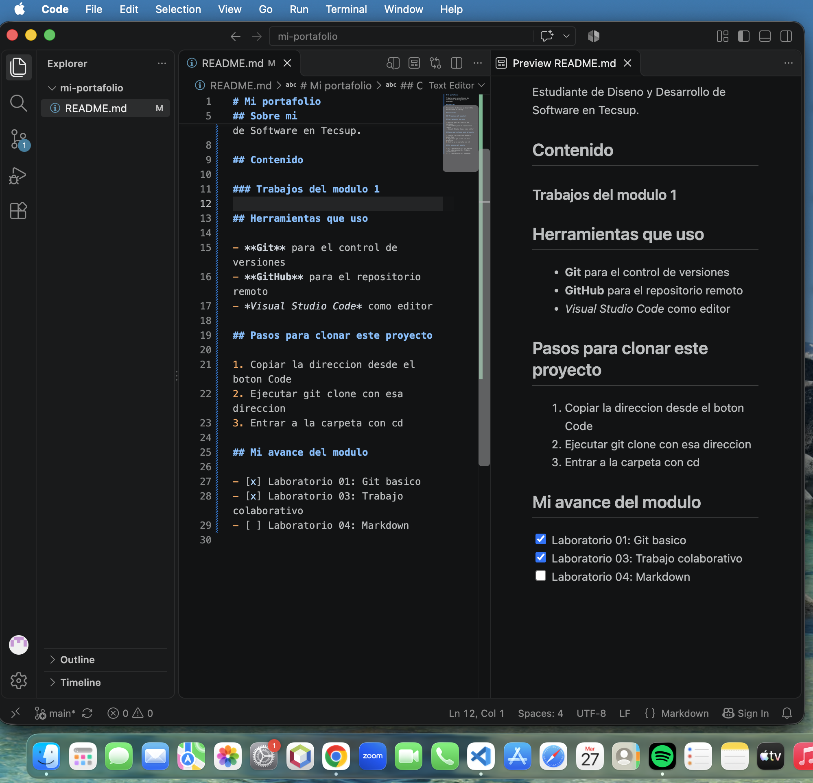

# Guía del proyecto Tienda TECSUP

Esta guía explica cómo utilizar el proyecto Tienda TECSUP, desarrollado durante el Laboratorio 3 del curso Diseño de Interfaces de Programación Avanzado.

## Descripción del proyecto

Tienda TECSUP es una página web que muestra productos, precios, cantidades y el total de un carrito de compras.

El proyecto utiliza HTML, CSS y JavaScript.

### Objetivo

Comprender el trabajo colaborativo con Git y GitHub, identificar errores en un proyecto y proponer correcciones mediante Issues y Pull Requests.


## Archivos del proyecto

- `index.html`: contiene la estructura de la tienda.
- `estilos.css`: define los colores y el diseño.
- `script.js`: calcula el total del carrito.
- `README.md`: explica el funcionamiento del proyecto.

## Pasos para utilizar el proyecto

1. Abrir el repositorio Tienda TECSUP en GitHub.
2. Descargar o clonar el repositorio en la computadora.
3. Abrir la carpeta del proyecto en Visual Studio Code.
4. Abrir `index.html` en Google Chrome.
5. Revisar los productos y el total del carrito.


## Actividades realizadas

- [x] Identificar los errores del carrito y los estilos CSS.
- [x] Crear los Issues #452 y #454 en GitHub.
- [x] Corregir los errores en ramas independientes.
- [x] Publicar los Pull Requests #453 y #455.
- [ ] Esperar la revisión y aceptación del docente.


## Tabla de archivos del proyecto

| Archivo | Función |
|---------|---------|
| index.html | Muestra la estructura de la tienda |
| estilos.css | Define los colores y el diseño |
| script.js | Calcula el total del carrito |
| README.md | Explica el funcionamiento del proyecto |


## Comandos para descargar el proyecto

Para descargar el repositorio en la computadora utilizamos el comando `git clone`.

```bash
git clone https://github.com/miguelalvareztt-pixel/tienda-tecsup.git
cd tienda-tecsup
```

Después de clonar el repositorio, podemos abrir sus archivos en Visual Studio Code.


## Enlaces del proyecto

- [Repositorio original de Tienda TECSUP](https://github.com/jeisson-tecsup/tienda-tecsup)
- [Mi repositorio de Tienda TECSUP](https://github.com/miguelalvareztt-pixel/tienda-tecsup)

## Captura de mi trabajo


